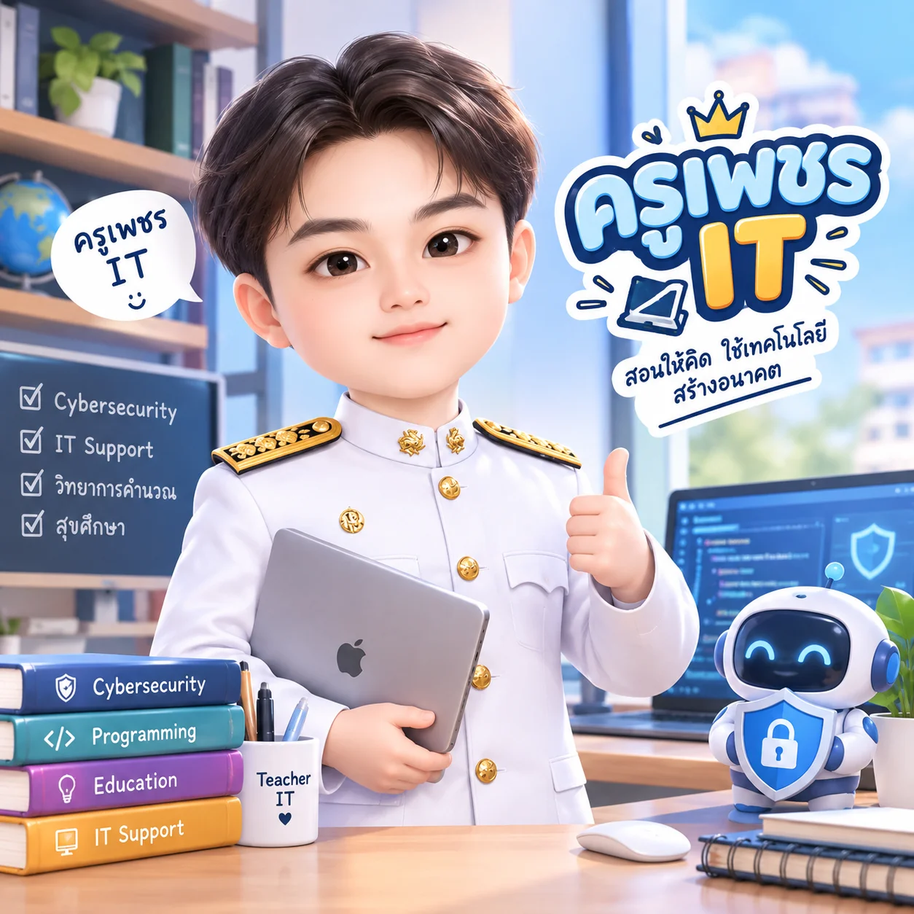
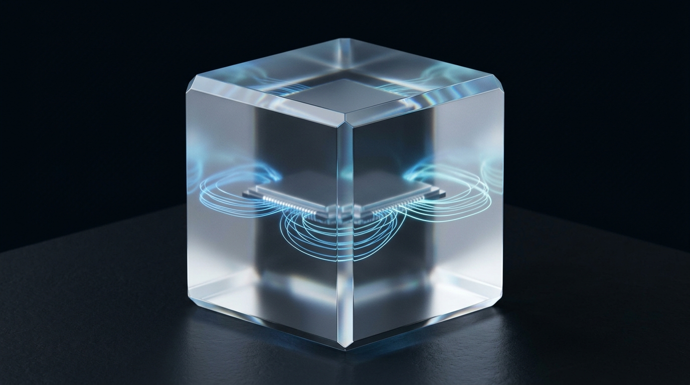

<div align="center">

  

  # 💎 KRU PETCH IT — HIGH-CRAFT EDITORIAL & EDTECH PORTFOLIO
  ### 💡 "สอนให้คิด ใช้เทคโนโลยี สร้างอนาคตและนวัตกรรม"
  **IT Educator • Creative Technologist • Cybersecurity & CTF Specialist**

  <p align="center">
    <a href="https://react.dev/"></a>
    <a href="https://vitejs.dev/"></a>
    <a href="https://www.khronos.org/webgl/"></a>
    <a href="https://threejs.org/"></a>
    <a href="https://www.framer.com/motion/"></a>
    <a href="https://github.com/Kamonphet/Portfolio-Phet"></a>
  </p>

  <p align="center">
    <a href="#-จุดเด่นและสถาปัตยกรรมโฉมใหม่-what-s-new-in-v6">✨ จุดเด่นโฉมใหม่ (v6)</a> •
    <a href="#-ระบบการออกแบบ-precision-light--tactile-glass">🎨 ระบบการออกแบบ</a> •
    <a href="#-tech-stack">🛠️ เทคโนโลยีที่ใช้</a> •
    <a href="#-การเข้าสู่ระบบ-admin--cms-access">🔑 ระบบ Admin & CMS</a> •
    <a href="#-การเพิ่มประสิทธิภาพและความปลอดภัย-performance--security">⚡ ประสิทธิภาพ & ความปลอดภัย</a> •
    <a href="#-การติดตั้งและเริ่มต้นใช้งาน-getting-started">🚀 เริ่มต้นใช้งาน</a>
  </p>

  ---
</div>

## 📖 เกี่ยวกับโปรเจกต์ (About Project)

**Kru Petch IT Portfolio** คือแพลตฟอร์มนำเสนอผลงานและตัวตนระดับมืออาชีพของ **ครูเพชร IT (กมลเพชร ศิริ)** — ครูผู้สอนเทคโนโลยีสารสนเทศ นักพัฒนานวัตกรรมสื่อการเรียนรู้ (EdTech) และผู้เชี่ยวชาญด้านความมั่นคงปลอดภัยไซเบอร์ (Cybersecurity & CTF)

โปรเจกต์นี้ได้รับการออกแบบและวางสถาปัตยกรรมใหม่ทั้งหมดภายใต้มาตรฐาน **[Impeccable v4.7 Craft Floor](DESIGN.md)** และ **[Shader Effects Architecture](src/components/BackgroundCanvas.jsx)** เพื่อผสาน **ความลื่นไหลระดับ 60fps**, **การเล่าเรื่องเชิงบรรณาธิการ (Editorial Storytelling)** และ **ความประณีตทางวิศวกรรม** เข้าไว้ด้วยกันอย่างลงตัว

### 4 แกนหลักความเชี่ยวชาญ (4 Core Pillars)
1. **EdTech & Active Learning Innovation:** ออกแบบสื่อนวัตกรรมการศึกษา บอร์ดเกมการศึกษา แพลตฟอร์มการเรียนรู้ออนไลน์ และแผนการจัดการเรียนรู้เชิงรุก
2. **Cybersecurity & CTF Coaching:** การพัฒนาแล็บจำลองสถานการณ์ความมั่นคงปลอดภัยทางไซเบอร์ และการฝึกสอนทักษะการคิดวิเคราะห์แก้โจทย์ Capture The Flag (CTF)
3. **Creative Web & 3D Interactive Media:** การพัฒนาเว็บแอปพลิเคชันสมัยใหม่ ผสาน WebGL Shaders, Three.js และสติกเกอร์สร้างสรรค์เพื่อการสื่อสารการเรียนรู้
4. **Systems & Classroom Research:** การบริหารจัดการโครงสร้างพื้นฐานไอทีสถานศึกษาควบคู่กับการทำวิจัยในชั้นเรียนเพื่อยกระดับผลสัมฤทธิ์ของผู้เรียน

---

## ✨ จุดเด่นและสถาปัตยกรรมโฉมใหม่ (What's New in v6)

| หมวดหมู่ | รายละเอียดการยกระดับ |
| :--- | :--- |
| 🌌 **WebGL GLSL Aurora Shader** | พื้นหลังขับเคลื่อนด้วย Custom Fragment Shader ประมวลผลบน GPU โดยตรง ผสมสีในปริภูมิ **OKLab** (Aurora MeshGradient) พร้อม **Interactive Cursor Light Field** ที่เคลื่อนตามเมาส์อย่างนุ่มนวล และ **Simplex Film Grain** บน GPU |
| 🏛️ **Impeccable v4.7 Craft Floor** | ผ่านการตรวจสอบด้วย `impeccable detect` **0 Anti-pattern Violations** — ปราศจากการ์ดซ้อนในการ์ด (Zero Nested Cards), ใช้สัดส่วนตัวเลข `tabular-nums` ทุกจุด, และจัดลำดับหัวข้ออย่างสง่างาม |
| 🌟 **Flagship Case Study Spotlight** | ไฮไลต์ผลงานชิ้นเอกในรูปแบบ **Asymmetric Editorial Split Layout** ด้านบนสุดของหมวดผลงาน เพื่อให้ผู้ชมเข้าใจโจทย์ แนวคิด และผลลัพธ์ได้ทันทีควบคู่กับ Interactive Carousel |
| 🧊 **Custom 3D Glass Editorial Assets** | ภาพประกอบไทม์ไลน์การศึกษาแบบ 3D Frosted Glass & Precision Light (`edu-school-craft.jpg`, `edu-university-craft.jpg`, `edu-graduate-craft.jpg`) ที่ออกแบบขึ้นเฉพาะสำหรับแต่ละระดับการศึกษา |
| 📊 **Hero Impact Strip & Capability Matrix** | แถบสรุปสถิติผลงานสำคัญตั้งแต่วินาทีแรกที่เข้าชม (`Hero.jsx`) และตารางทักษะ **Capability Matrix** (`Skills.jsx`) ที่สะท้อนทักษะจริงของสายการศึกษาและไอที พร้อมระดับความเชี่ยวชาญ |
| ⚡ **82% Smaller Initial Bundle** | แยก Vendor Chunks (`vendor-react`, `vendor-motion`, `vendor-three`) และทำ `React.lazy` สำหรับหน้าย่อยและ Modal ลดขนาดไฟล์เริ่มต้นจาก `1,049 kB` เหลือเพียง **`190.8 kB` (`53.2 kB` gzip)** |
| 📏 **Scroll Progress Hairline** | แถบเส้นแสงขนาด 2px ด้านบนสุดของ `Navbar` แสดงความคืบหน้าการอ่านเรื่องราวตั้งแต่ต้นจนจบ |

---

## 🎨 ระบบการออกแบบ: Precision Light & Tactile Glass

รายละเอียดฉบับเต็มถูกบันทึกไว้ใน **[PRODUCT.md](PRODUCT.md)** และ **[DESIGN.md](DESIGN.md)**:

- ☀️ **Light Mode (Alabaster Daylight — ค่าเริ่มต้น)**: พื้นหลังขาวนวลสะอาดตา (`#F8FAFC` / `#FFFFFF`) ตัดกับสีน้ำเงินครามคมชัดสูง (`#0284C7`) และตัวอักษร Slate เข้ม (`#0F172A`) ให้ความรู้สึกน่าเชื่อถือ โปร่งสบาย และอ่านง่ายในทุกสภาพแสง
- 🌙 **Dark Mode (Deep Void Obsidian)**: พื้นหลังดำลึก (`#030712`) พร้อมพื้นผิวกระจกฝ้า (`#0B1120`) และแสงสะท้อนสีฟ้า Electric Sky (`#38BDF8`) สะท้อนบรรยากาศห้องแล็บเทคโนโลยีและ Cybersecurity
- 🔤 **Typography System**:
  - **Display / Headings:** `Inter` + `IBM Plex Sans Thai` (Bold, Tracking กระชับ คมชัด)
  - **Body Copy:** `IBM Plex Sans Thai` (ความสูงบรรทัด `1.75–1.8` อ่านสบายตาสำหรับเนื้อหาภาษาไทย)
  - **Technical & Tabular Data:** `JetBrains Mono` พร้อม `font-variant-numeric: tabular-nums`

---

## 🖼️ ภาพตัวอย่างผลงานและสินทรัพย์ 3D (Visual Showcase)

<div align="center">
  <table>
    <tr>
      <td width="50%" align="center">
        
        <br />
        <b>🚀 EdTech & Learning Innovation</b>
      </td>
      <td width="50%" align="center">
        
        <br />
        <b>🛡️ Cybersecurity Defense & CTF</b>
      </td>
    </tr>
    <tr>
      <td width="50%" align="center">
        
        <br />
        <b>💻 Interactive Web & Media Studio</b>
      </td>
      <td width="50%" align="center">
        
        <br />
        <b>🎓 IT Educator & Pedagogical Specialist</b>
      </td>
    </tr>
  </table>
</div>

### 🧊 3D Glass Academic Milestone Illustrations
<div align="center">
  <table>
    <tr>
      <td width="33%" align="center">
        
        <br />
        <sub><b>Foundational Computing & Network</b></sub>
      </td>
      <td width="33%" align="center">
        
        <br />
        <sub><b>B.Ed. Computer Education (1st Class Honors)</b></sub>
      </td>
      <td width="33%" align="center">
        
        <br />
        <sub><b>M.Ed. AI & Cybersecurity Education</b></sub>
      </td>
    </tr>
  </table>
</div>

---

## 🔑 การเข้าสู่ระบบ Admin / CMS Access

ระบบจัดการเนื้อหาบนหน้าเว็บแบบอินไลน์ (Inline Content Management System) พร้อมระบบซิงก์ข้อมูลขึ้น Cloud (Google Sheets API):

### 1. การเปิดโหมดแก้ไข (2 ช่องทาง):
- **ผ่าน URL**: เติม `?admin` หรือ `?edit` ต่อท้ายลิงก์ เช่น `http://localhost:5173/?admin`
- **ผ่าน Keyboard Shortcut**: กดปุ่ม **`Ctrl` + `Shift` + `E`** (บน Mac: **`Cmd` + `Shift` + `E`**)

### 2. รหัสผ่านเริ่มต้น (Default Passcode):
```text
1234
```
> เมื่อยืนยันรหัสผ่านแล้ว คุณจะเข้าสู่ **Live Edit Mode** สามารถคลิกแก้ไขข้อความได้โดยตรงบนหน้าเว็บ หรือคลิกปุ่ม **CMS** บนแถบเมนูเพื่อเพิ่ม/ลบผลงาน ทักษะ และประสบการณ์

---

## ⚡ การเพิ่มประสิทธิภาพและความปลอดภัย (Performance & Security)

### 🚀 Performance Engineering
- **Single-Canvas WebGL Pipeline**: ยุบรวมเอฟเฟกต์พื้นหลังทั้งหมดไว้ใน WebGL Fragment Shader เดียว และหยุดเรนเดอร์อัตโนมัติเมื่อซ่อนแท็บ (`document.hidden`)
- **Rollup Manual Chunks & Lazy Routes**: แยก `vendor-react`, `vendor-motion`, `vendor-three` และโหลด `AllProjectsPage`, `ProjectDetailPage`, `EditModal`, `AuthModal` แบบ On-Demand
- **WebP & Optimized Assets**: ใช้ไฟล์ภาพ `.webp` ขนาดเบาพร้อม `loading="lazy"` สำหรับเนื้อหาด้านล่างของหน้า

### 🛡️ Cybersecurity & Secure Coding
- **Timing-Safe Password Comparison**: ป้องกัน Side-Channel Timing Attack ด้วยฟังก์ชัน `timingSafeCompare()`
- **Client-Side Brute-Force Lockout**: ล็อกการทดลองรหัสผ่านเป็นเวลา 30 วินาทีเมื่อกรอกผิดติดต่อกันเกินกำหนด
- **URL Sanitization**: ตรวจสอบลิงก์ภายนอกทั้งหมดด้วย `sanitizeUrl()` เพื่อป้องกัน `javascript:` / `data:` XSS

---

## 🛠️ เทคโนโลยีที่ใช้ (Tech Stack)

- **Core:** [React 18](https://react.dev/), [Vite 7](https://vitejs.dev/), [React Router 7](https://reactrouter.com/)
- **Graphics & Motion:** Custom WebGL GLSL Fragment Shader (OKLab Aurora & Simplex Grain), [Three.js](https://threejs.org/), [Framer Motion](https://www.framer.com/motion/), [Lenis Smooth Scroll](https://lenis.darkroom.engineering/)
- **Design System:** [Impeccable v4.7 Craft Floor](DESIGN.md), Custom CSS Design Tokens (Light & Dark Adaptive Themes)
- **Cloud & Messaging:** Google Sheets Cloud Sync (`portfolioService.js`), [EmailJS](https://www.emailjs.com/)

---

## 🚀 การติดตั้งและเริ่มต้นใช้งาน (Getting Started)

### ความต้องการของระบบ (Prerequisites)
- [Node.js](https://nodejs.org/) (เวอร์ชัน 18.0 ขึ้นไป แนะนำ 20+)
- [Git](https://git-scm.com/)

### ขั้นตอนการรันบนเครื่อง Local:

1. **โคลนคลังโค้ดนี้:**
   ```bash
   git clone https://github.com/Kamonphet/Portfolio-Phet.git
   cd Portfolio-Phet
   ```

2. **ติดตั้ง dependencies ทั้งหมด:**
   ```bash
   npm install
   ```

3. **รัน Development Server:**
   ```bash
   npm run dev
   ```
   > เปิดเข้าใช้งานได้ที่: `http://localhost:5173/`

4. **สร้าง Production Bundle:**
   ```bash
   npm run build
   npm run preview
   ```

---

## 📂 โครงสร้างโปรเจกต์ (Project Structure)

```plaintext
portfolio/
├── public/
│   ├── img/                        # คลังภาพผลงาน (.webp) และภาพ 3D Glass Editorial
│   │   ├── edu-school-craft.jpg    # ภาพ 3D Glass ระดับมัธยมศึกษา
│   │   ├── edu-university-craft.jpg# ภาพ 3D Glass ระดับปริญญาตรี
│   │   └── edu-graduate-craft.jpg  # ภาพ 3D Glass ระดับปริญญาโท
│   └── profile.jpg                 # ภาพโปรไฟล์หลัก
├── src/
│   ├── components/
│   │   ├── About.jsx               # Editorial Split Bio, Specification List & Academic Timeline
│   │   ├── AllProjectsPage.jsx     # หน้ารวมคลังผลงานทั้งหมด (Lazy-loaded)
│   │   ├── AuthModal.jsx           # Modal ยืนยันรหัสผ่าน Admin (Lazy-loaded)
│   │   ├── BackgroundCanvas.jsx    # WebGL GLSL Aurora Shader & Interactive Cursor Light
│   │   ├── Contact.jsx             # Unified Contact Directory & Direct Message Form
│   │   ├── EditModal.jsx           # Visual CMS Dialog (Lazy-loaded)
│   │   ├── Experience.jsx          # ไทม์ไลน์ประวัติการทำงานและประสบการณ์วิชาชีพ
│   │   ├── Footer.jsx              # ส่วนท้ายเว็บไซต์
│   │   ├── Hero.jsx                # หน้าต้อนรับ, Key Impact Strip & Action Buttons
│   │   ├── Hero3D.jsx              # โมเดล 3D โต้ตอบกับเมาส์ในส่วน Hero
│   │   ├── Navbar.jsx              # Glass Capsule Navigation & Scroll Progress Hairline
│   │   ├── ProjectDetailPage.jsx   # หน้ารายละเอียดผลงานแบบเจาะลึก (Lazy-loaded)
│   │   ├── Projects.jsx            # Flagship Case Study Spotlight & Interactive Carousel
│   │   └── Skills.jsx              # ตารางความเชี่ยวชาญ Capability Matrix
│   ├── context/
│   │   └── PortfolioContext.jsx    # State Management (ธีม, ภาษา, ข้อมูล v6, Cloud Sync)
│   ├── data/
│   │   └── defaultData.js          # ข้อมูลเนื้อหาตั้งต้น 2 ภาษา (TH / EN)
│   ├── lib/
│   │   └── portfolioService.js     # ระบบเชื่อมต่อฐานข้อมูล Google Sheets
│   ├── utils/
│   │   ├── crypto.js               # ระบบตรวจสอบรหัสผ่านแบบ Timing-Safe
│   │   └── security.js             # ฟังก์ชันตรวจสอบความปลอดภัยของ URL
│   ├── App.jsx                     # โครงสร้างหลัก, Lenis Scroll & Code-Split Routes
│   ├── index.css                   # Impeccable v4.7 Design Tokens & Craft Floor Styles
│   └── main.jsx                    # จุดเริ่มต้นการทำงานของแอปพลิเคชัน
├── DESIGN.md                       # เอกสารระบบการออกแบบ (Impeccable v4.7 Design System)
├── PRODUCT.md                      # เอกสารยุทธศาสตร์ผลิตภัณฑ์และการวางตำแหน่งแบรนด์
├── README.md                       # เอกสารประกอบโปรเจกต์ฉบับสมบูรณ์
└── vite.config.js                  # การตั้งค่า Vite และ Rollup Manual Chunks
```

---

## 👤 เกี่ยวกับผู้จัดทำ (Author & Contact)

**ครูเพชร IT (กมลเพชร ศิริ — Phet Kamonphet)**  
*ครูผู้สอนเทคโนโลยีสารสนเทศ • นักพัฒนานวัตกรรมการเรียนรู้ • ผู้เชี่ยวชาญด้าน Cybersecurity & CTF*

- 🐙 **GitHub:** [@Kamonphet](https://github.com/Kamonphet)
- 💼 **Repository:** [Portfolio-Phet](https://github.com/Kamonphet/Portfolio-Phet)
- 📧 **Email:** [kamonpach.siri@gmail.com](mailto:kamonpach.siri@gmail.com)

---

<div align="center">
  <p>⭐ หากโปรเจกต์นี้มีประโยชน์ อย่าลืมกด <b>Star</b> บน GitHub เพื่อเป็นกำลังใจให้ด้วยนะครับ! ⭐</p>
  <sub>Crafted with 💙 using Impeccable v4.7 & WebGL Aurora Shaders by Kru Petch IT</sub>
</div>
